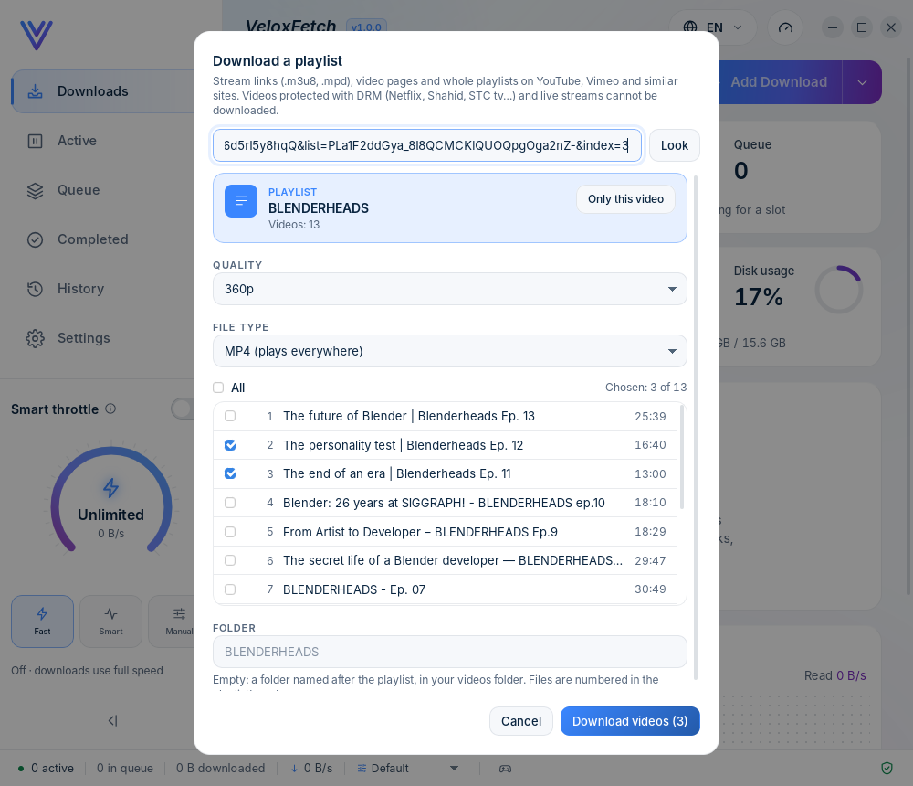
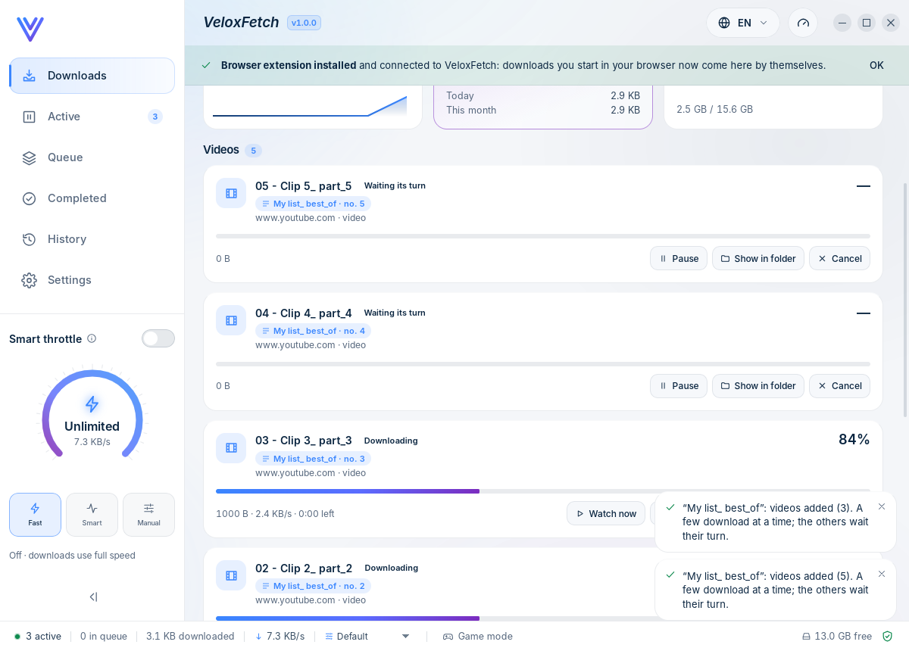

# Playlist downloads (v2.0.0)

Some users want a whole playlist, not one video: a YouTube playlist, a Vimeo showcase, a SoundCloud set, a
Dailymotion playlist. VeloxFetch reads the playlist, shows its videos, and downloads the ones the user picks, each as
its own video download.



## What the user sees

* **A playlist link** (`youtube.com/playlist?list=…`, typed in *Add Download › Download a video*, pasted, or sent from
  the browser): the video dialog becomes **Download a playlist**. A highlighted card shows the playlist's name and
  how many videos it has ("Videos: 13").
* **A video that is part of a playlist** (`watch?v=…&list=…`, such as a YouTube page opened from a playlist, or the
  browser's **Download video** bar on that page): the dialog shows the video as before, plus a box: *This video is
  part of a playlist* with **Download the whole playlist**. **Only this video** goes back.
* **The videos:** in the playlist's order, each with its number, title and length, all chosen at first. **All** ticks
  or clears every box; "Chosen: 3 of 13" counts them. Private, deleted, members-only and live videos are shown,
  greyed out, as *Unavailable*, and cannot be chosen.
* **One quality and one file type for all:** Best available, 2160p … 360p, or Audio only; MP4 / MKV / WebM, or the
  sound only as MP3 / M4A / Opus. Each video gets the closest quality it has, never more.
* **Folder:** empty means a folder named after the playlist, inside the videos folder (or the download folder when
  sorting by type is off). The files are numbered in the playlist's order: `02 - The personality test _ … .mp4`.
* **Download videos (3):** each chosen video becomes a normal video download, with its own progress, Pause, Resume,
  Retry, Watch now, Cancel and details page. A chip on each card says which playlist it comes from and its number in
  it ("BLENDERHEADS · no. 3").
* **A few at a time:** three video downloads run at once. The others say **Waiting its turn** and start by themselves,
  in order, as places free up. A waiting video can be paused (it is set aside and no longer starts by itself) or
  cancelled. This also applies to single videos: a fourth video now waits its turn instead of being refused.



## How it works

```text
playlist link ─ analyze_media ─▶ yt-dlp --flat-playlist -J (titles, lengths, links; no video is read)
                                  │  links of known video sites only, at most 500
                                  ▼
                    manager keeps the playlist (key "p7", 30 min, 8 at most); the window gets titles and positions
                                  │
window: start_playlist { key, items: [2, 3, 9], quality, format, subdir? }
                                  ▼
                    one video job per position, queued; start_queued() runs 3 at once, oldest first
```

* **Reading** (`media_engine::site`): the analysis adds `--flat-playlist --playlist-items 1:501` to the usual fixed
  yt-dlp arguments. A playlist link returns only its list, which is fast (13 videos in 1.4 s on the real test). A
  single video is read in full as before; `--no-playlist` keeps `watch?v=…&list=…` to the one video.
  `playlist_from_json` keeps an entry only when its link is a page of the sites VeloxFetch already reads
  (`is_site_page`), not a DRM service, not a playlist or channel itself, and has no user name or password in it. At most
  500 videos are kept; when the playlist has more, the card says so ("the playlist has 812; the first 500 are listed").
* **A video of a playlist:** `playlist_link` takes only the `list` id from the link (letters, digits, `-`, `_`; 2–64
  characters) and builds `https://www.youtube.com/playlist?list=<id>`. Nothing else from the link is used.
  `analyze_media` with `playlist: true` reads that page; for a video the browser sent, the waiting request's own link is
  used, with its referrer and user agent (never its cookies).
* **The window never sees a link.** `Analysis.playlist.entries[].url` is not serialised. The window chooses videos by
  their position; `start_playlist` checks the key, every position (it must exist, be available, and appear only once),
  the quality (`PLAYLIST_QUALITIES`), the file type and the folder (`validate::subdir`, inside the download folder).
* **Downloading:** each video is a `Work::Site` job like a single video (same arguments, rate limit, retries, history
  entry). The name is `<number> - <title>`, made safe by `sanitize_stem` and checked again by `validate::filename`,
  falling back to the number alone.
* **The queue** (`manager/media.rs`): a new job is `Queued`; `start_queued` starts queued jobs in list order while fewer
  than 3 run. It runs when a job is added, when one stops (end of `run_media`), on Resume and when a game ends. While
  Smart throttle's pause policy holds downloads (a game), nothing new starts. When the game ends, the jobs it paused go
  back in line first, so they start before the ones that were already waiting. Queued jobs keep the power action
  ("when downloads finish") waiting. Like every video job, the queue lives in memory: closing the app ends it.

The playlist pages VeloxFetch recognises are `PLAYLIST_PAGES` (Rust) and the same list in the window's `format.ts`; a
test keeps them in step. The browser extension does not need them: there is no video on a playlist page, and on a
video page of a playlist it already sends the whole address, `list=` included. The published extension is unchanged.

## Safety

* yt-dlp gets the same fixed argument list as for one video (`--ignore-config`, `--no-exec`, the link last after `--`,
  no cookies); `--flat-playlist` only lists, it downloads nothing.
* A hostile playlist cannot point VeloxFetch at another host, a local address, a file, another playlist or a DRM
  service: such entries are dropped while reading, before the window sees anything.
* The window sends positions only (`PlaylistRequest`, `deny_unknown_fields`): no link, path or command. `start_playlist`
  is a main-window-only command (capability file and `authz` matrix).
* Bounded: 500 videos per playlist, 8 playlists kept for 30 minutes, 3 downloads at once, the job list trims only
  finished jobs.

## Tests

* `media-engine` unit tests: a real YouTube flat list (trimmed) is read with positions, titles, lengths and
  availability. Other hosts, local addresses, `file:`, other playlists, DRM services and links with credentials are
  dropped. The list is cut at 500 and says so. `playlist_link` takes the id only. The analysis arguments include
  `--flat-playlist`, `--playlist-items 1:501` and `--no-playlist`.
* `tests/integration/tests/video.rs` (+5, fake yt-dlp):
  * chosen videos download in order into the playlist's folder;
  * every bad request is refused (unknown key, empty, a video twice, unavailable or unknown positions, bad quality or
    type, folders outside, a link field);
  * three at once, the others queued, and a fourth single video queues instead of failing;
  * pausing a queued job sets it aside, cancelling frees a place for the next, resuming when full queues it again;
  * a video of a playlist offers the playlist, and the browser's request is answered;
  * Game mode with the pause policy: waiting videos wait too, and the paused ones come back first.
* `tests/e2e/desktop-playlist.mjs`: the real window and a real native host.
  * From the browser: the offer, the playlist card, the list (an unavailable video cannot be chosen), All, the count
    and the button, quality and type.
  * Files in the playlist's folder, numbered; the chip on each card; the request answered; cookies never reach yt-dlp.
  * A typed playlist: three at once, *Waiting its turn* with Pause and Cancel, and the next one starting.
  * Hostile IPC requests are refused.
  * All 8 languages with long titles: nothing cut, no English left.
  * Writes `playlist-dialog.png`, `playlist-dialog-dark.png` and `playlist-jobs.png`.
* `tests/e2e/real-playlist.mjs` (by hand, internet, real yt-dlp / Deno / ffmpeg): Blender's "BLENDERHEADS" playlist,
  opened from one of its videos. All 13 videos are listed with real titles and lengths, read in 1.4 s. Three were chosen
  at 360p MP4 and downloaded in about 45 s into `BLENDERHEADS/`, numbered 02, 03 and 09. ffprobe found each file's
  length within 3 s of the site's, 360p, with sound. They are in the history. 17 October 2026: passed twice. Writes
  `playlist-real.png`.
